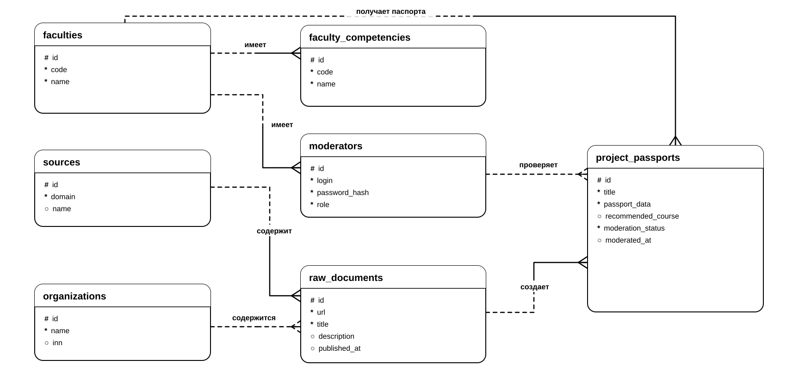

## Обозначения

`PK` — первичный ключ; `FK` — внешний ключ; `UNIQUE` — уникальность; `NOT NULL` — обязательное значение; `NULL` — значение может отсутствовать; `CHECK` — проверка допустимых значений.

## Таблицы

### `faculties` — факультеты

| Поле | Тип | Ограничения | Назначение |
|---|---|---|---|
| `id` | `BIGINT` | PK | Идентификатор факультета |
| `code` | `VARCHAR(64)` | UNIQUE, NOT NULL | Код факультета, например `IPMKN` |
| `name` | `VARCHAR(255)` | NOT NULL | Название факультета |

Один факультет может иметь несколько компетенций, модераторов и учебных паспортов.

### `sources` — источники

| Поле | Тип | Ограничения | Назначение |
|---|---|---|---|
| `id` | `BIGINT` | PK | Идентификатор сайта |
| `domain` | `VARCHAR(255)` | UNIQUE, NOT NULL | Домен источника |
| `name` | `VARCHAR(255)` | NULL | Название сайта |

Домен хранится в нижнем регистре, без протокола, пути и параметров URL. Источник не обязательно совпадает с организацией, упомянутой в публикации.

### `organizations` — организации

| Поле | Тип | Ограничения | Назначение |
|---|---|---|---|
| `id` | `BIGINT` | PK | Идентификатор организации |
| `name` | `VARCHAR(255)` | NOT NULL | Название организации |
| `inn` | `VARCHAR(12)` | UNIQUE, NULL | ИНН при наличии |

 При наличии ИНН его можно использовать для поиска существующей организации.

### `raw_documents` — сырые документы

| Поле | Тип | Ограничения | Назначение |
|---|---|---|---|
| `id` | `BIGINT` | PK | Идентификатор документа |
| `source_id` | `BIGINT` | FK → `sources.id`, NOT NULL, ON DELETE RESTRICT | Источник публикации |
| `organization_id` | `BIGINT` | FK → `organizations.id`, NULL, ON DELETE RESTRICT | Организация, если определена |
| `url` | `TEXT` | UNIQUE, NOT NULL | Нормализованный URL публикации |
| `title` | `TEXT` | NOT NULL | Заголовок |
| `description` | `TEXT` | NULL | Описание |
| `published_at` | `DATE` | NULL | Дата публикации |
| `collected_at` | `TIMESTAMPTZ` | NOT NULL, DEFAULT `now()` | Дата и время первого сбора |
| `text` | `TEXT` | NOT NULL | Текст публикации |
| `status` | `VARCHAR(16)` | NOT NULL, DEFAULT `'RAW'`, CHECK | Этап обработки |
| `updated_at` | `TIMESTAMPTZ` | NOT NULL, DEFAULT `now()` | Дата последнего изменения записи |

Ограничение статуса:

```sql
CONSTRAINT chk_raw_documents_status
CHECK (status IN ('RAW', 'REJECTED', 'CANDIDATE', 'GENERATED', 'APPROVED'))
```

| Статус | Значение |
|---|---|
| `RAW` | Документ сохранён, обработка не проводилась |
| `REJECTED` | Документ не подходит для дальнейшей обработки |
| `CANDIDATE` | Выделена потенциальная задача |
| `GENERATED` | По документу создан учебный паспорт |
| `APPROVED` | Есть одобренный учебный паспорт; правило для нескольких факультетов согласуется отдельно |

`published_at` может отсутствовать. `updated_at` при изменении записи обновляется Backend: `DEFAULT now()` задаёт значение только при вставке.

### `faculty_competencies` — компетенции факультетов

| Поле | Тип | Ограничения | Назначение |
|---|---|---|---|
| `id` | `BIGINT` | PK | Идентификатор компетенции |
| `faculty_id` | `BIGINT` | FK → `faculties.id`, NOT NULL, ON DELETE RESTRICT | Факультет |
| `code` | `VARCHAR(64)` | NOT NULL | Код компетенции |
| `name` | `VARCHAR(255)` | NOT NULL | Название |
| `description` | `TEXT` | NULL | Описание |

Ограничение: `UNIQUE (faculty_id, code)`.

### `project_passports` — учебные паспорта

| Поле | Тип | Ограничения | Назначение |
|---|---|---|---|
| `id` | `BIGINT` | PK | Идентификатор паспорта |
| `raw_document_id` | `BIGINT` | FK → `raw_documents.id`, NOT NULL, ON DELETE RESTRICT | Исходный документ |
| `faculty_id` | `BIGINT` | FK → `faculties.id`, NOT NULL, ON DELETE RESTRICT | Факультет |
| `title` | `TEXT` | NOT NULL | Название учебного проекта |
| `recommended_course` | `SMALLINT` | NULL, CHECK (от 1 до 4) | Рекомендуемый курс |
| `passport_data` | `JSONB` | NOT NULL | Содержимое паспорта |
| `moderation_status` | `VARCHAR(16)` | NOT NULL, DEFAULT `'PENDING'`, CHECK | Состояние модерации |
| `moderated_by_id` | `BIGINT` | FK → `moderators.id`, NULL, ON DELETE RESTRICT | Проверивший модератор |
| `moderated_at` | `TIMESTAMPTZ` | NULL | Дата решения модератора |
| `created_at` | `TIMESTAMPTZ` | NOT NULL, DEFAULT `now()` | Дата создания |
| `updated_at` | `TIMESTAMPTZ` | NOT NULL, DEFAULT `now()` | Дата последнего изменения |

Ограничения:

```sql
CONSTRAINT uq_project_passports_document_faculty
UNIQUE (raw_document_id, faculty_id),

CONSTRAINT chk_project_passports_moderation_status
CHECK (moderation_status IN ('PENDING', 'APPROVED', 'REJECTED')),

CONSTRAINT chk_project_passports_recommended_course
CHECK (recommended_course BETWEEN 1 AND 4)
```

Один документ может использоваться несколькими факультетами. Для каждой пары `(raw_document_id, faculty_id)` хранится один актуальный паспорт. При повторной генерации запись обновляется, отдельная версия не создаётся. При такой перегенерации `moderation_status` снова становится `PENDING`, а `moderated_by_id` и `moderated_at` сбрасываются в `NULL`. Поле `updated_at` обновляется.

В `passport_data` предусмотрены семь разделов со следующими именами ключей:

| Ключ | Содержание |
|---|---|
| `backlog` | Бэклог на четыре спринта |
| `roles` | Роли участников команды |
| `effort` | Трудоёмкость в часах |
| `course_routing` | Обоснование рекомендованного курса |
| `stack` | Технологический стек и возможные варианты реализации |
| `business_value` | Бизнес-ценность |
| `custdev_guide` | Вопросы для CustDev |

**Рекомендуемый курс:** значение хранится в `project_passports.recommended_course`. В `course_routing` хранится обоснование выбора, без второй копии числового значения курса. Конкретную структуру вложенных JSON-полей необходимо сверить со схемой Backend/AI.

### `moderators` — модераторы

| Поле | Тип | Ограничения | Назначение |
|---|---|---|---|
| `id` | `BIGINT` | PK | Идентификатор модератора |
| `faculty_id` | `BIGINT` | FK → `faculties.id`, NOT NULL, ON DELETE RESTRICT | Один факультет модератора |
| `login` | `VARCHAR(150)` | UNIQUE, NOT NULL | Логин |
| `password_hash` | `TEXT` | NOT NULL | Хэш пароля |
| `role` | `VARCHAR(32)` | NOT NULL | Роль пользователя |
| `is_active` | `BOOLEAN` | NOT NULL, DEFAULT `TRUE` | Активность учётной записи |
| `created_at` | `TIMESTAMPTZ` | NOT NULL, DEFAULT `now()` | Дата создания |

Модератор привязан к одному факультету. Проверять паспорта другого факультета ему нельзя.


## Связи между таблицами




| Родительская таблица | Дочерняя таблица | Дочерних записей у одной родительской | Родительских записей у одной дочерней | Внешний ключ |
|---|---|---|---|---|
| `faculties` | `faculty_competencies` | `0..N` | `1..1` | `faculty_competencies.faculty_id` |
| `faculties` | `moderators` | `0..N` | `1..1` | `moderators.faculty_id` |
| `faculties` | `project_passports` | `0..N` | `1..1` | `project_passports.faculty_id` |
| `sources` | `raw_documents` | `0..N` | `1..1` | `raw_documents.source_id` |
| `organizations` | `raw_documents` | `0..N` | `0..1` | `raw_documents.organization_id` |
| `raw_documents` | `project_passports` | `0..N` | `1..1` | `project_passports.raw_document_id` |
| `moderators` | `project_passports` | `0..N` | `0..1` | `project_passports.moderated_by_id` |

Связи `1:N` реализованы внешними ключами на стороне `N`. Поля `organization_id` и `moderated_by_id` могут быть `NULL`, остальные перечисленные внешние ключи обязательны.

### Связь факультетов с документами

Между `faculties` и `raw_documents` для сформированных паспортов существует связь `M:N`. Её реализует таблица `project_passports` с двумя внешними ключами. Ограничение `UNIQUE (raw_document_id, faculty_id)` обеспечивает один актуальный паспорт для каждой пары.

### Правила удаления связанных записей

Для всех внешних ключей используется `ON DELETE RESTRICT`: родительскую запись нельзя удалить, если на неё ссылаются дочерние записи. Это правило распространяется и на необязательные внешние ключи, когда они заполнены. Вместо удаления модератора можно установить `is_active = FALSE`.

## Индексы

| Таблица | Индекс или ограничение | Поля | Назначение |
|---|---|---|---|
| `raw_documents` | `uq_raw_documents_url` (UNIQUE) | `url` | Исключение повторных документов |
| `raw_documents` | `idx_raw_documents_published_at` | `published_at` | Поиск по дате публикации |
| `raw_documents` | `idx_raw_documents_status` | `status` | Поиск документов со статусом `RAW` воркером |
| `raw_documents` | `idx_raw_documents_source_id` | `source_id` | Выборка документов источника |
| `raw_documents` | `idx_raw_documents_organization_id` | `organization_id` | Выборка документов организации |
| `faculty_competencies` | `uq_faculty_competencies_faculty_code` (UNIQUE) | `faculty_id`, `code` | Уникальность компетенции; поиск по `faculty_id` |
| `moderators` | `idx_moderators_faculty_id` | `faculty_id` | Поиск модераторов факультета |
| `project_passports` | `uq_project_passports_document_faculty` (UNIQUE) | `raw_document_id`, `faculty_id` | Уникальность паспорта; поиск по `raw_document_id` |
| `project_passports` | `idx_project_passports_faculty_id` | `faculty_id` | Поиск паспортов факультета |
| `project_passports` | `idx_project_passports_moderated_by_id` | `moderated_by_id` | Поиск паспортов модератора |

Уникальные ограничения таблиц `faculties`, `sources`, `organizations`, `moderators` также создают индексы для своих уникальных полей. 

## Сохранение документов: `save_raw_documents()`


1. Удаляет пробелы по краям строки, проверяет URL и допустимую схему (`http` или `https`).
2. Приводит имя домена к нижнему регистру; не меняет регистр пути и значений параметров.
3. Удаляет фрагмент после `#`.
4. Удаляет параметры отслеживания с префиксом `utm_` (например, `utm_source`, `utm_medium`, `utm_campaign`). Остальные параметры запроса сохраняет, упорядочивая их в стабильном порядке.
5. Удаляет завершающий `/` из пути, если путь не является корневым. Корневой путь приводится к `/`.
6. Если известен конечный адрес после перенаправления, использует его и повторяет нормализацию. 


Домен сохраняется в `sources.domain`, нормализованный URL — в `raw_documents.url`.  Если URL уже присутствует, новая строка не создаётся и существующий статус не сбрасывается в `RAW`. Уникальность обеспечивает `UNIQUE (url)`. Функция возвращает количество сохранённых и пропущенных документов.

