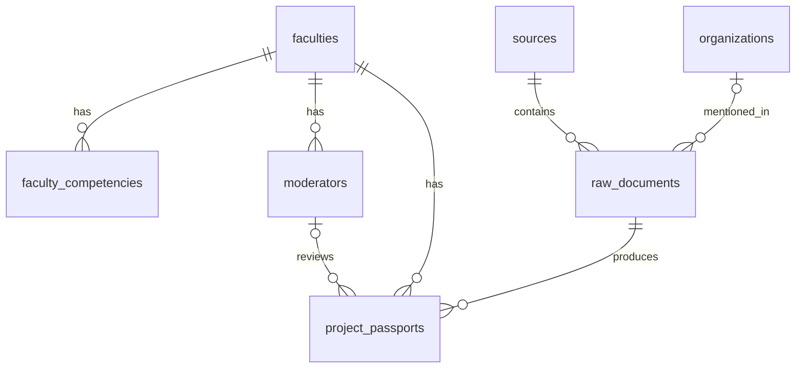

# Схема базы данных 

## Обозначения
 `PK` — первичный ключ, `FK` — внешний ключ, `UNIQUE` — уникальное значение, `NOT NULL` — обязательное поле, `NULL` — поле может отсутствовать.

##  Таблицы

### `faculties` — факультеты

| Поле | Тип | Ограничения | Назначение |
|---|---|---|---|
| `id` | `BIGINT` | PK | Идентификатор факультета |
| `code` | `VARCHAR(64)` | UNIQUE, NOT NULL | Краткий код, например `IPMKN` |
| `name` | `VARCHAR(255)` | NOT NULL | Название факультета |

Факультет связан со своими компетенциями, модераторами и учебными паспортами. Привязка нужна для последующего подключения других факультетов.

###  `sources` — источники

| Поле | Тип | Ограничения | Назначение |
|---|---|---|---|
| `id` | `BIGINT` | PK | Идентификатор источника |
| `domain` | `VARCHAR(255)` | UNIQUE, NOT NULL | Домен сайта |
| `name` | `VARCHAR(255)` | NULL | Название сайта |

Домен сохраняется в нижнем регистре, без протокола и пути. 

###  `organizations` — организации

| Поле | Тип | Ограничения | Назначение |
|---|---|---|---|
| `id` | `BIGINT` | PK | Идентификатор организации |
| `name` | `VARCHAR(255)` | NOT NULL | Название организации |
| `normalized_name` | `VARCHAR(255)` | NOT NULL, INDEX | Название в нормализованном виде для поиска совпадений |
| `inn` | `VARCHAR(12)` | NULL, UNIQUE | ИНН, если он известен |

Одна организация может упоминаться в нескольких документах. `normalized_name` не уникален: одинаковые названия не всегда означают одну компанию. Можно попробовать сопоставлять по ИНН при наличии у организации

### `raw_documents` — сырые документы

| Поле | Тип | Ограничения | Назначение |
|---|---|---|---|
| `id` | `BIGINT` | PK | Идентификатор документа |
| `source_id` | `BIGINT` | FK → `sources.id`, NOT NULL | Сайт, с которого получен текст |
| `organization_id` | `BIGINT` | FK → `organizations.id`, NULL | Организация, если удалось её определить |
| `url` | `TEXT` | UNIQUE, NOT NULL | Ссылка на исходную публикацию |
| `title` | `TEXT` | NOT NULL | Заголовок |
| `description` | `TEXT` | NULL | Краткое описание |
| `published_at` | `DATE` | NULL, INDEX | Дата публикации |
| `collected_at` | `TIMESTAMPTZ` | NOT NULL, DEFAULT `now()` | Дата и время сбора |
| `text` | `TEXT` | NOT NULL | Основной текст публикации |
| `status` | `VARCHAR(16)` | NOT NULL, DEFAULT `RAW` | Статус обработки |

Допустимые значения `status`:

| Статус | Значение |
|---|---|
| `RAW` | Документ сохранён, обработка ещё не проводилась |
| `REJECTED` | Документ отклонён |
| `CANDIDATE` | Найдена потенциальная задача для студентов |
| `GENERATED` | Сгенерирован учебный паспорт |
| `APPROVED` | Учебный проект прошёл проверку модератора |

Ограничения:

- `UNIQUE (url)` — один URL не должен сохраняться повторно.
- Индекс `idx_raw_documents_published_at` по полю `published_at`.
- Индексы по `source_id` и `organization_id` для выборки связанных документов.
- Допустимые статусы ограничиваются `CHECK` или PostgreSQL `ENUM`.
- При повторном сборе документа его статус не меняется обратно на `RAW`.

`published_at` может отсутствовать. `collected_at` заполняется при сохранении документа. 

### `faculty_competencies` — компетенции факультетов

| Поле | Тип | Ограничения | Назначение |
|---|---|---|---|
| `id` | `BIGINT` | PK | Идентификатор компетенции |
| `faculty_id` | `BIGINT` | FK → `faculties.id`, NOT NULL | Факультет |
| `code` | `VARCHAR(64)` | NOT NULL | Код компетенции |
| `name` | `VARCHAR(255)` | NOT NULL | Название |
| `description` | `TEXT` | NULL | Описание |

Ограничение: `UNIQUE (faculty_id, code)`.

Для анализа текста AI-модуль будет получать компетенции факультета из этой таблицы.

###  `project_passports` — учебные паспорта

| Поле | Тип | Ограничения | Назначение |
|---|---|---|---|
| `id` | `BIGINT` | PK | Идентификатор паспорта |
| `raw_document_id` | `BIGINT` | FK → `raw_documents.id`, NOT NULL | Документ, по которому создан проект |
| `faculty_id` | `BIGINT` | FK → `faculties.id`, NOT NULL | Факультет |
| `title` | `TEXT` | NOT NULL | Название проекта |
| `recommended_course` | `SMALLINT` | NULL, значение от 1 до 4 | Рекомендуемый курс |
| `passport_data` | `JSONB` | NOT NULL | Содержание паспорта |
| `moderation_status` | `VARCHAR(16)` | NOT NULL, DEFAULT `PENDING` | Результат проверки паспорта |
| `moderated_by_id` | `BIGINT` | FK → `moderators.id`, NULL | Модератор, принявший решение |
| `moderated_at` | `TIMESTAMPTZ` | NULL | Дата решения |
| `created_at` | `TIMESTAMPTZ` | NOT NULL, DEFAULT `now()` | Дата создания |
| `updated_at` | `TIMESTAMPTZ` | NOT NULL, DEFAULT `now()` | Дата последнего изменения |

`passport_data` содержит семь частей учебного паспорта:

1. Бэклог на четыре спринта.
2. Роли участников команды.
3. Трудоёмкость в часах.
4. Рекомендуемый курс и обоснование.
5. Технологический стек: no-code и web-сценарии.
6. Бизнес-ценность.
7. Вопросы для CustDev.

Предлагаемые значения `moderation_status`: `PENDING`, `APPROVED`, `REJECTED`. Они относятся к конкретному паспорту и не заменяют статусы исходного документа.

### 2.7. `moderators` — модераторы

| Поле | Тип | Ограничения | Назначение |
|---|---|---|---|
| `id` | `BIGINT` | PK | Идентификатор модератора |
| `faculty_id` | `BIGINT` | FK → `faculties.id`, NOT NULL | Факультет |
| `login` | `VARCHAR(150)` | UNIQUE, NOT NULL | Логин |
| `password_hash` | `TEXT` | NOT NULL | Хэш пароля |
| `role` | `VARCHAR(32)` | NOT NULL | Роль пользователя |
| `is_active` | `BOOLEAN` | NOT NULL, DEFAULT `TRUE` | Активность учётной записи |
| `created_at` | `TIMESTAMPTZ` | NOT NULL, DEFAULT `now()` | Дата создания |

Авторизация выполняется в самом сервисе. В базе хранится только `password_hash`, а не исходный пароль.

## 3. Связи между таблицами

| Таблица | Связанная таблица | Тип связи | Внешний ключ |
|---|---|---|---|
| `faculties` | `faculty_competencies` | 1:N | `faculty_competencies.faculty_id` |
| `faculties` | `moderators` | 1:N | `moderators.faculty_id` |
| `faculties` | `project_passports` | 1:N | `project_passports.faculty_id` |
| `sources` | `raw_documents` | 1:N | `raw_documents.source_id` |
| `organizations` | `raw_documents` | 1:N | `raw_documents.organization_id` |
| `raw_documents` | `project_passports` | 1:N | `project_passports.raw_document_id` |
| `moderators` | `project_passports` | 1:N | `project_passports.moderated_by_id` |

## 4. Сохранение документов

Парсер передаёт название организации, URL, заголовок, описание, дату публикации, домен и текст. Backend проверяет URL, затем находит или создаёт источник и организацию и сохраняет новый документ со статусом `RAW`.

При повторном получении того же URL запись не добавляется. Функция `save_raw_documents()` должна возвращать количество сохранённых и пропущенных документов. 
